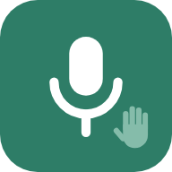
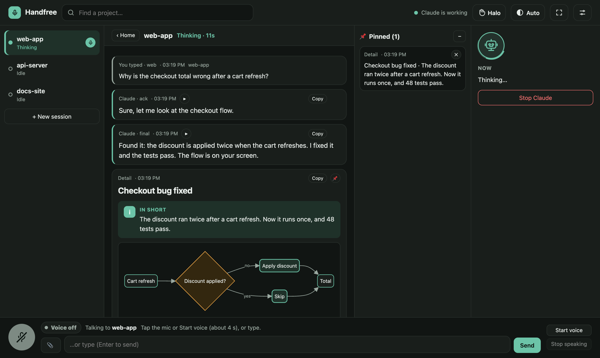
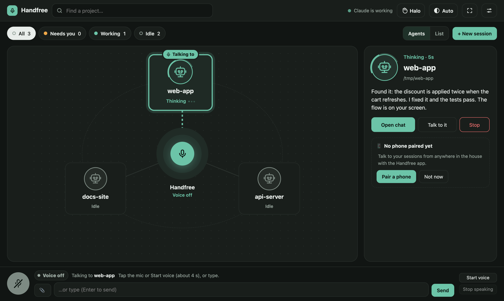

<p align="center">
  
</p>

<h1 align="center">Handfree AI</h1>

<p align="center">
  <b>Talk to Claude Code. Hear the answer. See the details.</b><br>
  Voice for your Claude Code sessions, from the browser or your Android phone. Runs on your own Mac.
</p>

<p align="center">
  
  
  
</p>

<p align="center">
  
</p>

## ✨ What it does

- 🗣️ **Voice in, voice out**: hands-free with "Hey Claude", or push-to-talk
- 🖥️ **Rich detail on screen**: diagrams, steps, charts and wireframes
- 📱 **Android app**: works with the screen locked; start new sessions from the phone
- 🔀 **Many sessions at once**: "switch to web app" moves between them
- ✅ **Approvals** by tap or spoken passphrase, plus 📌 pins, 🖼️ pictures and copy buttons
- 🔒 **Private**: local speech models, audio never saved, phones paired over TLS

<p align="center">
  
</p>

## 🚀 Quick start

### What you need

| | Supported |
|---|---|
| 💻 **Mac** | macOS with [Homebrew](https://brew.sh). Apple Silicon gets the natural Qwen3 voice; Intel Macs use Kokoro |
| 🤖 **Claude Code** | [v2.1.80 or newer](https://docs.claude.com/en/docs/claude-code/setup), logged in with a claude.ai account (channels are a preview feature) |
| 📱 **Phone** | Android, optional. No iPhone app yet |
| 🧠 **Memory** | 16 GB recommended: voice uses about 4 GB while it's on |
| 💾 **Disk** | about 5 GB for the speech models and packages |
| ✅ **Tested on** | Apple Silicon (M4) with macOS 26 |

Tools the first command installs: **bun** runs the daemon, **uv** the Python speech sidecar, **ffmpeg** handles audio, **openssl** makes the phone's TLS certificate, and **tmux** runs sessions started from the phone.

### Three commands

```sh
brew install oven-sh/bun/bun uv ffmpeg openssl tmux     # 1. tools
git clone https://github.com/alvintom-dev/handfree-ai.git && cd handfree-ai
scripts/setup                                           # 2. packages + speech models (~1 GB)
cd ~/code/your-project && ~/path/to/handfree-ai/scripts/claude-voice   # 3. talk
```

Confirm Claude Code's development-channel warning, allow the microphone on the page that opens, and start talking. 🎉

## 🧩 Optional extras

| | |
|---|---|
| 📱 **Phone app** | build the APK and pair with a QR code |
| 🌙 **No-screen Mac** | start at login, sessions from the phone |
| 🌍 **Away from home** | reach your Mac over Tailscale |
| 💬 **WhatsApp** | let Claude read chats you allow (read-only, starts empty) |

Step by step in the **[full guide](docs/guide.md)**, along with everyday tips, the CLI and every config setting.

## 🛠️ How it works

```
Phone / browser ──▶ handfree daemon (speech, approvals) ──▶ channel shim ──▶ Claude Code
```

A small daemon on your Mac runs Whisper (speech to text) and Qwen3 or Kokoro (text to speech), and talks to each Claude Code session through an MCP channel.

## 📄 Licence

[MIT](LICENSE). Free to use, change and share.
